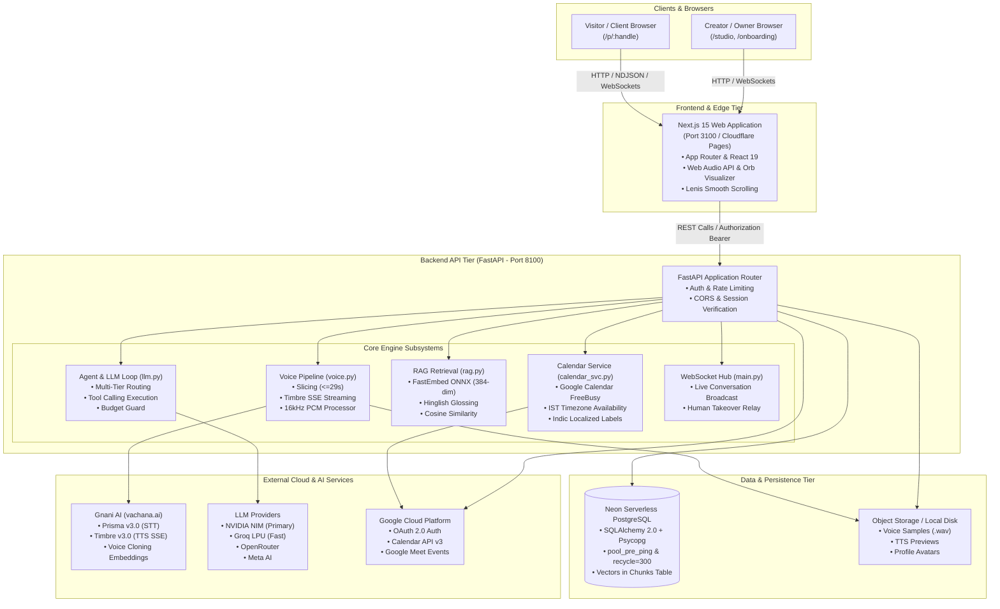
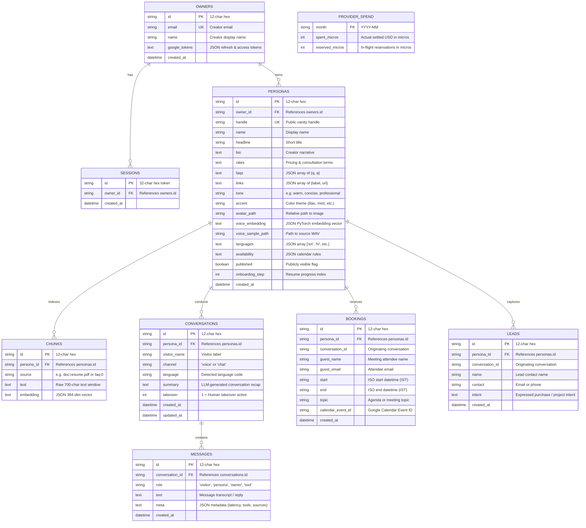
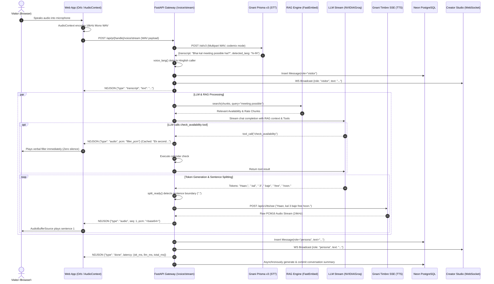
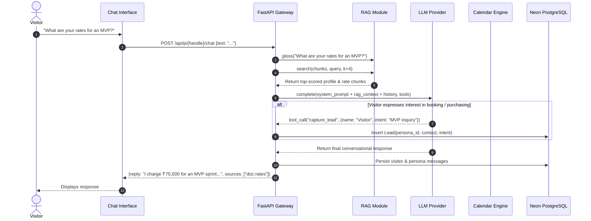
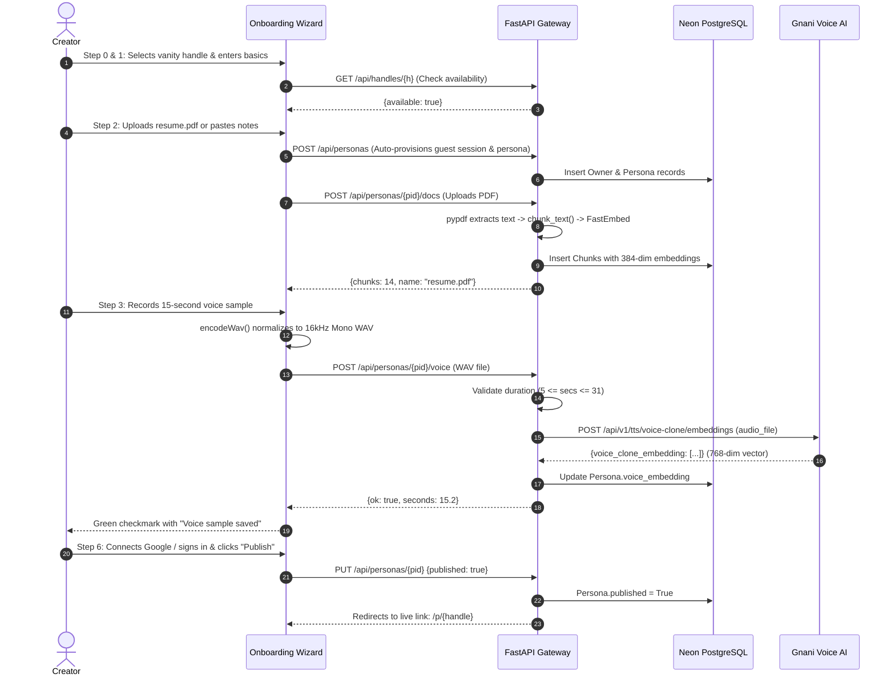
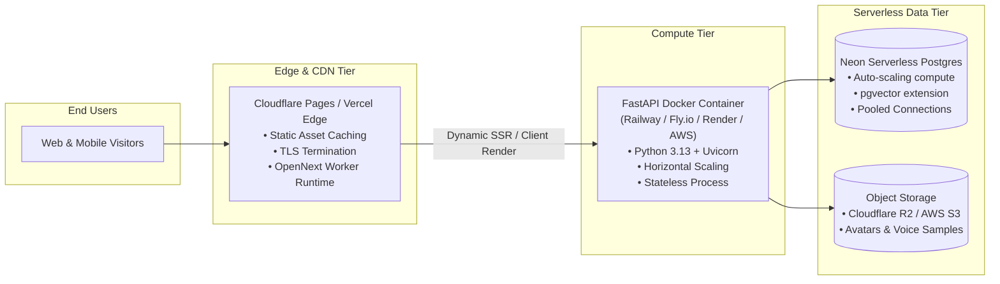

# Twyn AI — Complete System Architecture

This document provides a comprehensive, technically accurate architectural specification of the **Twyn AI** platform based strictly on the production codebase and active system configuration.

---

## 1. Executive Overview & System Philosophy

**Twyn AI** enables creators, consultants, and founders to create an interactive, autonomous **AI Twin** (a "Twyn"). Visitors to a creator's public profile (`/p/{handle}`) can:
1. **Talk (Real-time Voice Call):** Converse naturally with ultra-low latency voice synthesis using the creator's cloned voice and speech tone, with native support for Indic languages and Indian English (Hinglish, Hindi, Tamil, Telugu, Kannada, Bengali).
2. **Chat (Interactive Text):** Ask questions answered exclusively from the creator's curated knowledge base using Retrieval-Augmented Generation (RAG).
3. **Book (Autonomous Calendar Scheduling):** Check real-time free/busy availability and directly book meetings into the creator's connected Google Calendar or local scheduling rules engine.
4. **Lead Generation:** Automatically capture visitor identities and commercial intents during conversations.
5. **Live Human Takeover:** Allow creators to monitor live conversations in real-time via WebSockets from their Studio dashboard and intervene instantly.

### Core Architectural Principles
- **Low-Latency Streaming Voice:** Employs concurrent asynchronous worker pipelines where the LLM token stream is segmented at natural sentence boundaries and immediately piped into Server-Sent Events (SSE) TTS streaming. Audio begins playback in the browser before the LLM finishes generating the full response.
- **Verbal Fillers for Zero Perceived Latency:** When an LLM executes a tool call (such as querying calendar availability), the system immediately dispatches a cached, localized spoken filler (e.g., *"One sec, checking the calendar"* / *"Ek second, calendar dekh raha hoon"*), eliminating awkward silence.
- **Resilient Multi-Tier Fallback Chain:**
  - **LLM:** Meta AI (with micro-spend budget locks) $\rightarrow$ NVIDIA AI Endpoints $\rightarrow$ Groq LPU $\rightarrow$ OpenRouter (with micro-spend budget locks) $\rightarrow$ Deterministic Mock Brain.
  - **Voice:** Gnani Prisma v3 & Timbre v3 $\rightarrow$ Browser Web Speech synthesis.
  - **Calendar:** Google Calendar API $\rightarrow$ Configurable Local Deterministic Engine.
  - **RAG Embeddings:** FastEmbed (ONNX Multilingual MiniLM) $\rightarrow$ Deterministic Token Hash Embedder.
- **Local-First Onboarding:** Allows creators to test handle availability, draft their persona, upload knowledge docs, and clone their voice with zero upfront friction via guest session auto-provisioning, transitioning to authenticated Google accounts at publish time.

---

## 2. Comprehensive Tech Stack

| Layer | Technologies & Libraries | Purpose & Justification |
| :--- | :--- | :--- |
| **Frontend Framework** | **Next.js 15** (`15.5.28`, App Router), **React 19** (`19.1.0`), **TypeScript 5** | Server-side rendering, dynamic route handling (`/p/[handle]`, `/studio/*`), strict type safety, modern React server/client component model. |
| **Styling & Animation** | **Tailwind CSS v4**, **Motion** (Framer Motion `^14.9.0`), **Lenis** (`^1.3.27`) | Modern CSS-first design system with custom pastel claymorphism/glassmorphism design tokens; fluid inertial page scrolling; micro-interactions. |
| **Icons & Brand** | **@phosphor-icons/react** (`^2.1.10`) | Uniform, weight-flexible icon library (Thin, Light, Regular, Bold, Fill, Duotone) across all screens. |
| **Web Audio Subsystem** | **Web Audio API**, `AudioContext`, `OfflineAudioContext`, `AnalyserNode` | Client-side 16 kHz mono WAV encoding (`encodeWav`), PCM16 streaming playback, real-time frequency analysis powering the interactive audio Orb. |
| **Edge / Cloudflare Build** | **@opennextjs/cloudflare**, **Wrangler** | Production-ready edge deployment support targeting Cloudflare Workers / Pages. |
| **Backend Framework** | **Python 3.13**, **FastAPI**, **Uvicorn**, **Starlette** | Asynchronous HTTP/REST API gateway, NDJSON streaming responses (`StreamingResponse`), WebSocket connection hubs, multipart file streaming. |
| **Database & ORM** | **SQLAlchemy 2.0**, **Psycopg 3**, **Neon Serverless PostgreSQL** (or SQLite fallback) | Fully typed ORM; serverless connection pooling with `pool_pre_ping=True` and `pool_recycle=300` to survive Neon scale-to-zero; pgvector vector store readiness. |
| **Document Processing** | **pypdf** (`PdfReader`), Python standard `io` | In-memory text extraction from uploaded PDF resumes, portfolios, and FAQs without external OCR dependencies. |
| **Vector Search (RAG)** | **FastEmbed** (`sentence-transformers/paraphrase-multilingual-MiniLM-L12-v2`), **HashEmbedder** | Local ONNX multilingual 384-dimensional embeddings (no external API calls required); semantic glossing for romanized Hinglish; in-database JSON cosine vector similarity search. |
| **Voice AI (STT & TTS)** | **Gnani AI (`vachana.ai`)**<br>• *Prisma v3.0* (STT)<br>• *Timbre v3.0 / vachana-vc-v1* (TTS)<br>• *Voice Clone Embeddings* | High-accuracy Indic and Indian English speech recognition with auto-codemix detection; ultra-realistic text-to-speech with SSE streaming; 10-30s one-shot voice cloning. |
| **LLM Inference** | **NVIDIA NIM**, **Groq Cloud**, **OpenRouter**, **Meta AI** | Fast function-calling LLM inference with low latency; dynamic budget reservation system protecting monthly API quotas. |
| **Calendar & Auth** | **Google Identity & OAuth 2.0**, **Google Calendar API v3** | Google sign-in; calendar free/busy lookup; automated Google Meet link generation and event scheduling. |
| **Object Storage** | **Local Disk / AWS S3 Compatible** (Cloudflare R2, MinIO) | Storage for audio voice samples, previews, and creator avatars. |

---

## 3. High-Level System Architecture

The following diagram illustrates how clients, edge delivery, the FastAPI application gateway, database, and third-party AI services interconnect:



---

## 4. Backend Architecture & Module Breakdown

The backend is organized into specialized asynchronous modules located in `api/app/`:

### 4.1 `app.config` — Centralized Environment & Feature Detection
- Reads environment configuration from `.env` files with priority fallback.
- **Database URL Normalization:** Automatically converts `postgres://` or `postgresql://` URIs to `postgresql+psycopg://` and ensures `sslmode=require` is appended for secure Neon DB connections.
- **Dynamic Mode Detection (`modes()`):** Reports the real-time operational status of LLMs (NVIDIA, Groq, OpenRouter, Meta, or Mock), Voice (Gnani or Mock), Calendar (Google or Mock), and Database driver.
- **Safety Caps:** Enforces strict limits: `MAX_AUDIO_BYTES` (8MB), `MAX_DOC_BYTES` (10MB), `MAX_IMAGE_BYTES` (3MB), `MAX_TEXT_CHARS` (1500 chars), and per-IP rate limiting (`RATE_LIMIT_PER_MIN=30`).

### 4.2 `app.db` — Data Layer & Persistence Models
- Manages connection lifecycle with Neon Serverless Postgres via SQLAlchemy 2.0.
- Implements `pool_pre_ping=True` and `pool_recycle=300` to handle Neon's serverless scale-to-zero behavior (discarding stale sockets without throwing `500` errors on subsequent queries).
- Maintains database schema migrations inline via `init_db()` ensuring newly added columns (`languages`, `availability`, `published`, `onboarding_step`, `avatar_path`) are migrated automatically without schema drops.

### 4.3 `app.voice` — Voice AI Pipeline (Gnani Integration)
- **STT (`stt`):** Transcribes audio via Gnani Prisma v3 REST API (`/stt/v3`, model `prisma-v3.0`, language `indic-auto`, format `codemix`). Contains audio chunking logic (`_split_wav`) that slices recordings into $\le 29\text{s}$ parts to adhere to REST payload restrictions, transcribing long takes concurrently.
- **TTS (`tts` & `tts_stream`):** Synthesizes speech using Gnani Timbre v3.0 REST inference or Timbre SSE streaming (`/api/v1/tts/sse`).
  - Supports cloned speaker embeddings via model `vachana-vc-v1`.
  - Streams raw 16-bit linear PCM mono audio at $24{,}000\text{ Hz}$ (`STREAM_RATE=24000`), yielding audio segments to the client as each phrase completes.
- **Voice Cloning (`clone_embedding`):** Submits 16kHz audio samples (5–30s) to Gnani Voice Clone API (`/api/v1/tts/voice-clone/embeddings`) and stores the extracted PyTorch embedding vector (`torch.bfloat16`, shape `[1, 768]`) in the database.
- **Audio Utility (`wav_seconds`, `encodeWav`):** Parses RIFF/WAVE headers directly to validate clip durations and sample rates.

### 4.4 `app.llm` — Multi-Tier LLM Chain & Tool Execution
- **Provider Chain:** Executes completion requests with prioritized failover:
  1. `nvidia`: `integrate.api.nvidia.com` (`openai/gpt-oss-20b` or custom NIM)
  2. `groq`: `api.groq.com` (`openai/gpt-oss-120b` / Llama 3)
  3. `openrouter`: `openrouter.ai` (`openai/gpt-4o-mini`)
  4. `meta`: `api.meta.ai` (`muse-spark-1.3`)
  5. `mock`: Deterministic rule-based fallback answering from profile and context.
- **Budget Guard (`_reserve_meta` / `_settle_meta`):** Prevents exceeding monthly provider limits using atomic reservations in the `provider_spend` table before sending LLM requests.
- **Function Calling Tools:** Exposes three core tools to the LLMs:
  - `check_availability(days)`: Generates open booking slots.
  - `book_meeting(start, guest_name, guest_email, topic)`: Reserves a slot on the calendar.
  - `capture_lead(name, contact, intent)`: Records prospective clients into the lead pipeline.

### 4.5 `app.rag` — Retrieval-Augmented Generation & Hinglish Glossing
- **Local Embedding:** Uses FastEmbed (`sentence-transformers/paraphrase-multilingual-MiniLM-L12-v2`, 384 dimensions) running locally via ONNX Runtime without external API costs or latency.
- **Hinglish Semantic Glossing (`gloss`):** Multilingual models embed native Devanagari script well, but poorly embed Latin-script Hinglish (e.g., *"Bhai aapka rate kitna hai?"*). The `GLOSS` translation table maps common Romanized Hindi particles (*kya*, *kitna*, *paisa*, *milna*, *kal*, *bhai*) to equivalent English semantic terms prior to embedding, dramatically boosting vector search recall.
- **Chunking:** Slices knowledge documents into 700-character windows with a 120-character overlap.
- **Scoring:** In-memory cosine similarity search filtered by persona ownership and thresholded by `RAG_MIN_SCORE` ($0.27$).

### 4.6 `app.calendar_svc` — Scheduling Engine & Localized Speech
- Computes meeting slots in Indian Standard Time (`IST = UTC+05:30`) based on persona rules (working days, start/end hours, meeting duration, buffers, minimum advance notice).
- Evaluates busy blocks by combining confirmed Twyn bookings and external Google Calendar events (`FreeBusy` API).
- **Localized Slot Strings (`local_label`):** Formats meeting slots into natural, spoken phrases in English, Hinglish, Hindi, Tamil, Telugu, Kannada, and Bengali. The LLM is instructed to copy these strings verbatim so dates and times are never misspoken.

### 4.7 `app.main` — API Gateway, Streaming & Live Takeover
- Orchestrates HTTP request lifecycles, dev/guest auth tokens, Google OAuth redirects, and static asset streaming.
- **WebSocket Hub (`Hub`):** Maintains active client sockets per conversation. Broadcasts visitor and persona messages to the Studio dashboard in real-time.
- **Live Takeover (`/api/conversations/{cid}/takeover`):** Sets `conv.takeover = 1`, disabling autonomous AI responses and granting the creator direct control to chat with the visitor.

---

## 5. Frontend Architecture & Component Hierarchy

The frontend is built using Next.js 15 App Router (`web/app/`):

```
web/app/
├── layout.tsx              # Root HTML, fonts, Lenis smooth scrolling, metadata
├── page.tsx                # Landing page (Hero, ASCII BG, interactive call cards, FAQ)
├── login/page.tsx          # Google OAuth entry & local dev login
├── onboarding/page.tsx     # 7-Step Creator Setup Wizard
├── p/[handle]/page.tsx     # Public Persona Experience (Talk, Chat, Book tabs)
├── studio/                 # Creator Studio Shell
│   ├── page.tsx            # Studio Dashboard Overview (metrics, recent convos)
│   ├── persona/page.tsx    # Profile details, bio, FAQs, links, rates
│   ├── voice/page.tsx      # Voice cloning manager & audio preview
│   ├── availability/page.tsx # Meeting rules (hours, days, buffers, notice)
│   ├── bookings/page.tsx   # Confirmed calendar bookings
│   ├── leads/page.tsx      # Captured leads table with contact details & intent
│   ├── conversations/page.tsx # Live conversation viewer with takeover & reply
│   └── settings/page.tsx   # Google account linking, account deletion
└── lib/
    └── api.ts              # API client, token handling, audio conversion
```

### Core UI Components
- **`Orb.tsx`:** An interactive 3D-styled animated visualizer rendered on an HTML5 `<canvas>`. Analyzes audio frequencies via a Web Audio `AnalyserNode` during voice calls, pulsing organically to caller speech and Twin synthesized output.
- **`VoiceCloner.tsx`:** Handles microphone capture, duration countdowns (5–30s), live audio preview, and client-side conversion to 16kHz mono WAV via `encodeWav()`. Features distinct, non-ambiguous visual error indicators (never displaying false-positive success checks).
- **`AiImport.tsx`:** Provides creators with specialized, ready-to-copy prompts tailored for ChatGPT, Claude, Gemini, or Grok. Creators paste their answers, and Twyn parses and indexes the structured knowledge directly.
- **`SmoothScroll.tsx`:** Implements Lenis smooth inertial scrolling with support for `prefers-reduced-motion`.

---

## 6. Database Schema & Data Models

The persistence layer uses SQLAlchemy 2.0 mapped to PostgreSQL tables:



---

## 7. End-to-End Request & Data Flows

### 7.1 Flow 1: Low-Latency Streaming Voice Call (`POST /api/p/{handle}/voice/stream`)

This flow handles real-time bidirectional voice conversations over HTTP NDJSON streaming:



---

### 7.2 Flow 2: Public Chat with RAG & Tool Calling (`POST /api/p/{handle}/chat`)



---

### 7.3 Flow 3: Onboarding & Voice Cloning (`/onboarding`)



---

## 8. APIs & Endpoint Reference

### 8.1 Health & Diagnostics
| Method | Endpoint | Auth | Description |
| :--- | :--- | :--- | :--- |
| `GET` | `/api/health` | Public | Returns real-time subsystem operational modes (`llm`, `voice`, `calendar`, `db`). |
| `GET` | `/api/health/db` | Public | Executes ping query (`SELECT 1`) against PostgreSQL to test pool connectivity. |

### 8.2 Authentication & Account Management
| Method | Endpoint | Auth | Description |
| :--- | :--- | :--- | :--- |
| `POST` | `/api/auth/dev` | Public (Dev mode) | Auto-provisions developer / guest token for seamless onboarding. |
| `GET` | `/api/auth/google/login` | Public | Generates Google OAuth 2.0 URL requesting Calendar & Profile scopes. |
| `GET` | `/api/auth/google/callback` | Public | Exchanges Google code for tokens, persists owner, and redirects to dashboard. |
| `POST` | `/api/auth/logout` | Bearer Token | Deletes current session from `sessions` table. |
| `GET` | `/api/me` | Bearer Token | Returns authenticated owner profile, personas list, and Google Calendar status. |
| `DELETE` | `/api/me` | Bearer Token | Cascades deletion of all owner records, personas, chunks, and sessions. |
| `POST` | `/api/me/google/disconnect` | Bearer Token | Revokes stored Google OAuth tokens and reverts to local calendar rules. |

### 8.3 Persona & Knowledge Configuration
| Method | Endpoint | Auth | Description |
| :--- | :--- | :--- | :--- |
| `GET` | `/api/handles/{h}` | Public | Checks whether a vanity handle is free or taken. |
| `GET` | `/api/me/personas` | Bearer Token | Retrieves all personas owned by the authenticated user. |
| `POST` | `/api/personas` | Bearer Token | Creates a new persona draft. |
| `PUT` | `/api/personas/{pid}` | Bearer Token | Updates bio, rates, FAQs, links, tone, availability rules, and publish state. |
| `GET` | `/api/personas/{pid}/docs` | Bearer Token | Lists indexed knowledge files and their chunk counts. |
| `POST` | `/api/personas/{pid}/docs` | Bearer Token | Uploads `.pdf`, `.txt`, or `.md` files; extracts text, generates vector embeddings, and stores chunks. |
| `DELETE` | `/api/personas/{pid}/docs/{name}` | Bearer Token | Removes all vector chunks associated with a specific document. |
| `POST` | `/api/personas/{pid}/knowledge` | Bearer Token | Imports structured Q&A sections generated from external AI prompts. |
| `POST` | `/api/personas/{pid}/voice` | Bearer Token | Uploads 16kHz audio sample to create Gnani voice clone embedding. |
| `POST` | `/api/personas/{pid}/voice/preview` | Bearer Token | Synthesizes and caches an introductory phrase in the creator's cloned voice. |
| `POST` | `/api/personas/{pid}/avatar` | Bearer Token | Uploads and crops creator profile picture. |

### 8.4 Public Visitor Interactions (`/p/{handle}`)
| Method | Endpoint | Auth | Description |
| :--- | :--- | :--- | :--- |
| `GET` | `/api/p/{handle}` | Public | Fetches public profile, bio, tone, accent color, and voice capability. |
| `GET` | `/api/p/{handle}/avatar` | Public | Streams creator profile image. |
| `GET` | `/api/p/{handle}/slots` | Public | Returns open meeting times calculated from calendar rules and busy blocks. |
| `POST` | `/api/p/{handle}/book` | Public | Books an appointment, creates Google Calendar event with Meet link, and records lead. |
| `POST` | `/api/p/{handle}/chat` | Public (Rate-limited) | Executes RAG text query turn with tool calling and context citations. |
| `POST` | `/api/p/{handle}/voice` | Public (Rate-limited) | Synchronous voice turn: audio in $\rightarrow$ STT $\rightarrow$ LLM $\rightarrow$ TTS audio out. |
| `POST` | `/api/p/{handle}/voice/stream` | Public (Rate-limited) | **Streaming voice turn:** NDJSON streaming yielding transcript, tokens, raw PCM chunks, and latency metrics. |

### 8.5 Studio Dashboard & Real-Time Monitoring
| Method | Endpoint | Auth | Description |
| :--- | :--- | :--- | :--- |
| `GET` | `/api/personas/{pid}/overview` | Bearer Token | Aggregates metrics: total bookings, captured leads, conversation count, and monthly spend. |
| `GET` | `/api/conversations/{cid}` | Bearer Token | Returns complete message transcript and metadata for a conversation. |
| `POST` | `/api/conversations/{cid}/takeover` | Bearer Token | Toggles human takeover flag, muting autonomous AI responses. |
| `POST` | `/api/conversations/{cid}/reply` | Bearer Token | Injects creator's human response into the live conversation thread. |
| `WS` | `/ws/conversations/{cid}` | Bearer Token / Public | Live bidirectional WebSocket connection for instant message streaming. |

---

## 9. Integrations Deep-Dive

### 9.1 Gnani AI (`vachana.ai`)
- **Speech-to-Text (STT):** Endpoint `https://api.vachana.ai/stt/v3` with model `prisma-v3.0`. Automatically detects code-mixed spoken phrases across 10 Indian languages.
- **Text-to-Speech (TTS):** Endpoint `https://api.vachana.ai/api/v1/tts/sse` with model `timbre-v3.0` (or `vachana-vc-v1` for cloned voices). Yields 16-bit linear PCM audio in Server-Sent Events.
- **Voice Cloning:** Endpoint `https://api.vachana.ai/api/v1/tts/voice-clone/embeddings`. Extracts high-dimensional speaker characteristics from a short WAV recording.

### 9.2 LLM Providers & Cost Management
- **Primary:** NVIDIA NIM (`integrate.api.nvidia.com`) for high-throughput, low-latency function calling.
- **Secondary:** Groq (`api.groq.com`) using custom LPU hardware for near-instant token streaming.
- **Tertiary:** OpenRouter (`openrouter.ai`) as a multi-model fallback.
- **Budget Control:** The `ProviderSpend` model enforces a hard monthly expenditure ceiling (e.g., $\$30$ USD) using atomic row-level reservation locks before dispatching requests.

### 9.3 Google Calendar & OAuth 2.0
- Requests offline access (`access_type=offline`, `prompt=consent`) to obtain long-lived refresh tokens.
- Queries `freeBusy.query` across a 30-day horizon.
- Inserts confirmed appointments via `events.insert` with `conferenceDataVersion=1`, automatically attaching unique Google Meet video links to confirmed bookings.

---

## 10. Hosting, Deployment & Infrastructure Topology



### Local Development Setup
- **API Server:** Executed via `run-api.cmd` running `python -m uvicorn app.main:app --port 8100 --reload`.
- **Frontend Server:** Executed via `run-web.cmd` running `npx next dev -p 3100`.
- **Database Connection:** Connects via SSL to Neon Serverless PostgreSQL over standard port 5432.

### Production Deployment Strategy
1. **Frontend:** Build with `@opennextjs/cloudflare` via `npm run build` and deploy to Cloudflare Pages or Vercel. Set `NEXT_PUBLIC_API_URL` to the production backend domain.
2. **Backend:** Packaged as a lightweight container (Python 3.13-slim) running Uvicorn behind a reverse proxy (Nginx or Cloudflare Tunnel) on Railway, Fly.io, or AWS ECS.
3. **Database:** Managed Neon PostgreSQL cluster with connection pooling enabled.
4. **Environment Variables:** Production environments require `DATABASE_URL`, `GNANI_API_KEY`, `NVIDIA_API_KEY` (or `GROQ_API_KEY`), `GOOGLE_CLIENT_ID`, `GOOGLE_CLIENT_SECRET`, and `ALLOW_DEV_LOGIN=0`.

---

## 11. Security, Resilience & Rate Limiting

- **Input Sanitization & Filename Safety:** Files uploaded to `/api/personas/{pid}/docs` and `/voice` are stripped of directory traversal sequences via `safe_name()` and enforced with byte-size caps.
- **In-Memory Rate Limiter:** Protects public inference endpoints (`/api/p/{handle}/chat`, `/voice`, `/voice/stream`) against automated scraping and credit depletion using a sliding 60-second window per client IP (`RATE_LIMIT_PER_MIN=30`).
- **Authorization Guard (`owned`):** Every administrative endpoint verifying persona modification validates that the requesting session token matches the persona's `owner_id`, returning `404` or `401` on mismatch.
- **Data Privacy & Erasure:** The `/api/me` endpoint supports complete GDPR-compliant account deletion, cascading removals across owners, sessions, personas, chunks, leads, and conversations.
